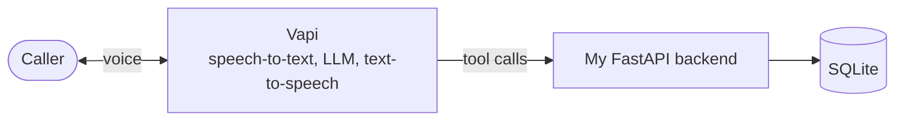

# Clinic Voice Receptionist

An AI phone receptionist for a primary-care clinic. Callers can book, reschedule, or cancel appointments, ask basic questions, and get handed off to a person when needed.

**Demo video (90 sec):** https://youtu.be/c2R5ylxYUc4

> Demo project. "Riverside Family Medicine" is fictional and all patient data is fake.

## How it works



Vapi handles the phone call, speech recognition, the LLM, and the voice. When the agent needs to check the schedule or make a change, it calls my backend.

## What I built

- **Conversation design** ([`prompts/system_prompt.md`](prompts/system_prompt.md)): identity check with name and date of birth, a full read-back before any change, and safety rules (no medical advice; emergencies are told to call 911).
- **Six backend tools** ([`app/tools.py`](app/tools.py)): check availability, book, find, reschedule, cancel, and transfer to a human.
- **Database** ([`app/schema.sql`](app/schema.sql)): the database itself blocks double-booking.
- **Errors the agent can recover from**: each error tells the agent what to say next (for example, offer other times when a slot is taken).
- **Logging** of every tool call, used to debug test calls.
- **60 automated tests.**

## Testing

I made 9 scripted test calls covering 16 scenarios and fixed 11 issues. Full details: [`docs/testing_log.md`](docs/testing_log.md).

The most interesting bug: speech-to-text heard my name, Parboni, as "Carboni" on one call and "Orboni" on the next. The backend's fuzzy name matching then booked the second mistake onto the first one's record. Now the backend asks the caller to confirm the name before booking.

## Run it

Requires Python 3.10+, an [ngrok](https://ngrok.com) account, and a [Vapi](https://vapi.ai) account.

```bash
python3 -m venv .venv && source .venv/bin/activate
pip install -r requirements.txt
cp .env.example .env                 # add your VAPI_API_KEY
python -m app.seed                   # fake test data
python -m pytest
uvicorn app.main:app --reload --reload-dir app --port 8000
```

In a second terminal, run `ngrok http 8000`, put the https URL in `.env` as `PUBLIC_URL`, then run `python scripts/setup_vapi.py`. Open the assistant in the Vapi dashboard and click **Talk to Assistant**.

## Next steps

- Connect a real calendar or EHR scheduling system.
- Deploy the backend instead of running it locally.
- Add SMS confirmations.
- Automate test calls so prompt changes are checked like code.
