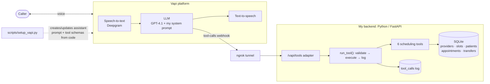

# Clinic Voice Receptionist

>  **Demo project.** "Riverside Family Medicine" is fictional and every patient record is fake. No real patient information is used anywhere.

**An AI phone receptionist for a primary-care clinic that books, reschedules, and cancels appointments, answers front-desk questions, and knows when to hand off to a human, backed by a scheduling API I built and tested.**

🎥 **Demo video (90 sec):** https://youtu.be/c2R5ylxYUc4

---

## What it does

A caller talks to "Riley," a voice agent, who can:

- **Book** an appointment: checks real availability, offers a few times, collects name (with spelling) and date of birth, reads everything back, then books.
- **Reschedule or cancel**: verifies identity with name + date of birth before touching anything.
- **Answer FAQs**: hours, address, insurance, parking, new-patient info.
- **Hand off to a human**: on request, when the caller is frustrated or confused, or for anything clinical (refills, results, billing).
- **Stay safe**: never gives medical advice; for emergency symptoms, immediately tells the caller to hang up and call 911.

## Architecture



## What I built vs. what Vapi provides

| Vapi provides | I built |
|---|---|
| Telephony / browser calling | **System prompt and conversation design**: greeting, identity verification, mandatory read-back before any change, name spelling, interruption and mind-change handling, emergency and no-medical-advice guardrails, escalation rules ([`prompts/system_prompt.md`](prompts/system_prompt.md)) |
| Speech-to-text and text-to-speech | **Scheduling backend** with 6 tools: `check_availability`, `book_appointment`, `find_appointment`, `reschedule_appointment`, `cancel_appointment`, `transfer_to_human` ([`app/tools.py`](app/tools.py)) |
| Hosting the LLM and turn-taking | **Data model**: SQLite schema where a partial unique index makes double-booking impossible at the database level, even under concurrent calls ([`app/schema.sql`](app/schema.sql)) |
| Calling my server when the LLM picks a tool | **Errors written for the agent**: every failure returns a code plus an `agent_hint` telling the LLM how to recover out loud (slot taken → offer alternatives; DOB mismatch → re-ask without revealing data) |
| | **Voice-specific API design**: results include a pre-formatted `spoken` string, a short list of options spread across different times, and "next available date" instead of dead ends |
| | **Identity matching built for speech recognition**: exact date-of-birth match + fuzzy name match ("Jon Smyth" → John Smith) |
| | **Observability**: every tool call logged with inputs, result, error code, latency, and Vapi call ID ([`scripts/show_logs.py`](scripts/show_logs.py)) |
| | **Infrastructure as code**: the Vapi assistant (prompt, tools, voice, transcriber) is generated from the repo; tool JSON schemas come from the same Pydantic models the API validates with, so they can't drift ([`vapi/assistant_config.py`](vapi/assistant_config.py)) |
| | **Tests**: pytest suite covering every tool, error path, the Vapi webhook format, and the generated config, with a frozen clock so date logic is deterministic |

## Testing & iteration

I tested the agent with 9 voice calls covering 16 scripted scenarios: happy paths and messy cases (wrong DOB, misheard names, two patients with the same name, a patient with two appointments, changing mind mid-booking, past and weekend dates, off-topic requests, emergencies, and requests for medical advice). Double-booking under concurrency is covered by automated tests rather than a live call. Each failure was traced through the tool-call log and transcript to a root cause, then fixed in the prompt, the code, or the config, with a regression test where possible.

Selected findings (full log: [`docs/testing_log.md`](docs/testing_log.md); scripts: [`docs/test_scripts.md`](docs/test_scripts.md)):

| Problem observed | Root cause | Fix |
|---|---|---|
| Booked a patient as "Carboni" instead of "Parboni" | Speech-to-text misheard an uncommon name; the agent never confirmed it | Prompt: always ask the caller to spell their last name, and require a full read-back (name, DOB, time, provider, reason) before booking |
| Offered "1 PM with Dr. A, 1 PM with Dr. B, 1 PM with NP C" | API returned the earliest 5 slots; several providers were free at the same time | Code: offered slots now spread across distinct times (+ regression test) |
| Goodbye spoken twice | Agent's goodbye + platform's end-call message | Config: removed the platform message |
| Second misheard name ("Orboni") was **booked onto the earlier misheard "Carboni" record** | Fuzzy name matching, built to tolerate speech errors, silently reused a near-match during booking, so one bad record attracted later errors | Backend now returns `CONFIRM_NAME` and books only after the caller confirms the name on file; prompt requires spelling first *and* last name (+ 3 regression tests) |
| Caller said "Ayesha Raman" for patient Aisha Rahman | Speech-to-text spelling | ✅ No fix needed: `PATIENT_NOT_FOUND` + agent hint → agent asked for spelling → found and cancelled |
| Vapi rejected assistant creation | 40-character name limit; voice retired by the platform | Config fixes + regression test |

**Results:** 9 test calls covering 16 scenarios (booking, reschedule, cancel, FAQs, transfer, wrong DOB, misheard names, duplicate patient names, multiple appointments, mind changes, past/weekend dates, off-topic, medical-advice and emergency guardrails). 11 issues found and fixed across prompt, backend, config, and ops. 60 automated tests. Backend tool calls answered in under 15 ms.

## Run it locally

Requires Python 3.10+, an [ngrok](https://ngrok.com) account, and a [Vapi](https://vapi.ai) account.

```bash
python3 -m venv .venv && source .venv/bin/activate
pip install -r requirements.txt
cp .env.example .env                 # then fill in VAPI_API_KEY
python -m app.seed                   # fake providers, 2 weeks of slots, test patients
python -m pytest                     # run the test suite
uvicorn app.main:app --reload --reload-dir app --port 8000
```

In a second terminal: `ngrok http 8000`, put the https URL in `.env` as `PUBLIC_URL`, then:

```bash
python scripts/setup_vapi.py         # creates the Vapi assistant (or updates it)
```

Open the Vapi dashboard → Assistants → **Talk to Assistant**.

Debugging: `python scripts/show_logs.py --errors` · `GET /logs?call_id=…` · API docs at `localhost:8000/docs`.

## Project structure

```
app/            FastAPI app, tool logic, schema, seed data
prompts/        System prompt (versioned in git)
vapi/           Builds the Vapi assistant config from code
scripts/        setup_vapi.py, show_logs.py
tests/          pytest suite
docs/           Test scripts and testing log
```

## Next steps

- **Real calendar / EHR integration**: replace SQLite with Google Calendar or an EHR scheduling API (e.g. FHIR `Slot`/`Appointment`).
- **Stronger verification**: require DOB again on cancel/reschedule, rate-limit lookups, and authenticate the webhook with a Vapi credential.
- **SMS confirmations and reminders** after booking.
- **Automated conversation evals**: replay scripted test calls with a simulated caller and score them, so prompt changes are regression-tested like code.
- **Deploy** the backend (Render/Fly) instead of a local tunnel, with Postgres.
- **HIPAA-ready setup** if ever used with real data: BAAs with vendors, encryption, audit logging, data retention policy.
